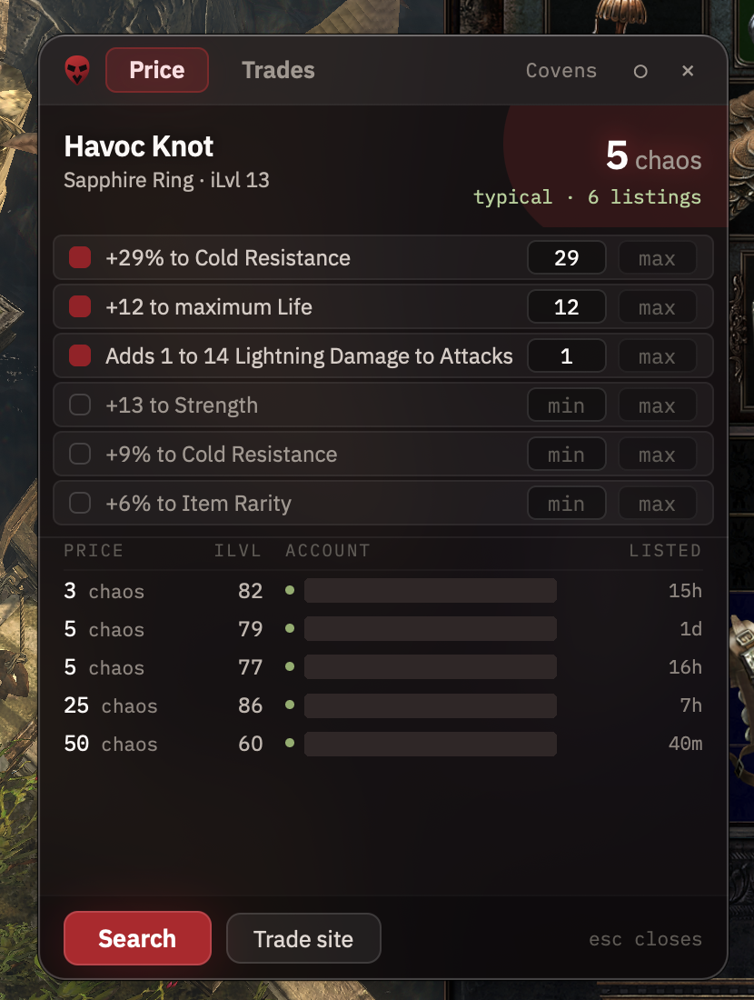

# ExileWorth

**Price check Path of Exile 1 items without leaving the game.** Hover an item to compare live trade listings, narrow results by modifier, and handle trade whispers from a compact overlay.

Free and open source for macOS and Windows. Formerly Vaaluation.

[Website](https://wild-butterfly.github.io/ExileWorth/) · [Guides](https://wild-butterfly.github.io/ExileWorth/guides/) · [Release notes](https://github.com/wild-butterfly/ExileWorth/releases) · [Report an issue](https://github.com/wild-butterfly/ExileWorth/issues/new/choose)

## Download

| Platform | Build | Default price check | Setup |
| --- | --- | --- | --- |
| macOS 14+ · Apple silicon and Intel | [Download for Mac](https://github.com/wild-butterfly/ExileWorth/releases/download/v0.1.6-macos/ExileWorth-0.1.6-macOS.zip) | <kbd>Control</kbd> + <kbd>D</kbd> | [Mac setup](https://wild-butterfly.github.io/ExileWorth/guides/install/) |
| Windows 11 x64 · Preview | [Download for Windows](https://github.com/wild-butterfly/ExileWorth/releases/download/v0.1.17/ExileWorth-0.1.17-Windows-x64.zip) | <kbd>Ctrl</kbd> + <kbd>Shift</kbd> + <kbd>D</kbd> | [Windows setup](https://wild-butterfly.github.io/ExileWorth/guides/windows/) |

Use the English Path of Exile 1 client in **Windowed** or **Windowed Fullscreen** mode. Select **Covens** for Covens of Umbra.

## See it in game

### Price Check



### Trades


*The Trades screenshot shows a simulated whisper.*

| Feature | What you can do |
| --- | --- |
| **Price Check** | Compare asking prices from the official trade service and refine the search by modifier. |
| **Trades** | Enable chat log watching to see incoming trade requests. Send replies, invites, or trade requests with a click. Edit, add, or remove quick replies in Settings. |
| **Currency** | Compare exchange rates for currencies such as Divine, Chaos, and Exalted Orbs. |

## First launch

- **Mac:** Unzip the signed and notarized build, move `ExileWorth.app` to **Applications**, and open it. Grant Accessibility when prompted so ExileWorth can copy items and send the trade commands you choose. If the app still shows **Permission needed**, [refresh the permission for the installed copy](https://wild-butterfly.github.io/ExileWorth/guides/install/).
- **Windows:** Extract the entire ZIP and run `ExileWorth.exe` from the extracted folder. The default price check copies the item with <kbd>Ctrl</kbd> + <kbd>C</kbd> to avoid triggering the game's Alt-based tooltip pin.
- **Both:** Bring Path of Exile to the front, hover an inventory item, and press your price check shortcut. Change the shortcut in **Settings**. See the [price check guide](https://wild-butterfly.github.io/ExileWorth/guides/price-check/) for modifier filters and search tips.

## Privacy

No account or telemetry. Item text is parsed locally, and price searches use the official trade API. Trade watching is optional and starts off by default. When enabled, the chat log is read locally and trade buttons send one command per press.

Read the [privacy statement](docs/PRIVACY.md) for details.

## Development

See the [macOS build and development guide](docs/DEVELOPMENT.md), [Windows build instructions](apps/windows/README.md), and [architecture notes](docs/ARCHITECTURE.md).

```bash
npm ci
npm run typecheck && npm run lint && npm test
```

[Contributing](CONTRIBUTING.md) · [MIT License](LICENSE)

ExileWorth is a community project and is not affiliated with or endorsed by Grinding Gear Games. Path of Exile artwork belongs to Grinding Gear Games. IBM Plex is licensed under the SIL Open Font License.
